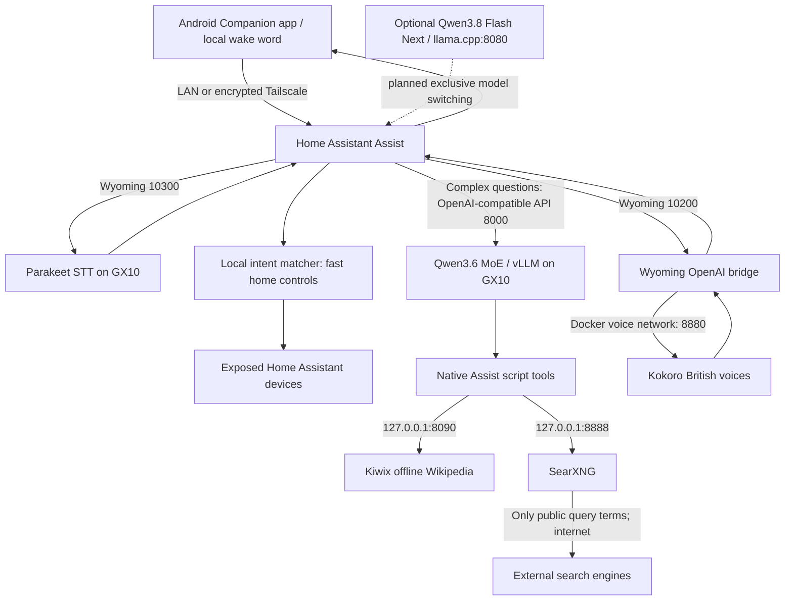

# GX10 local Home Assistant voice assistant

A reproducible build journal for an ASUS GX10 / NVIDIA GB10: local home-control intents, a fast MoE language model, Parakeet speech recognition, Kokoro British speech, and optional offline Wikipedia and web search.

**Snapshot: 8 November 2026 (Europe/London, GMT). Experimental; not a turnkey appliance. Local repository only; no publication or remote configured.** No licence has been selected: see [LICENSE](LICENSE).

## What it does

- Keeps model inference and speech processing on the GX10. Home Assistant handles supported simple commands locally before asking the LLM.
- Answers general questions using Qwen3.6-35B-A3B; can use explicitly exposed native Assist scripts for offline Wikipedia or current web results.
- Works with an Android Home Assistant Companion app and an on-device wake word (the tested choice was “Hey Jarvis”). Remote access uses Tailscale.
- Can control supported, paired, exposed Home Assistant entities. Actual lights/sockets/blinds were not yet installed and validated in this snapshot.

“Local” is not “never uses a network”: initial downloads require internet; optional web search sends queries to search engines; remote phone access uses Tailscale and may relay encrypted traffic. Disabling web search and testing locally without internet is still required to demonstrate the complete offline experience.

## Architecture

All services are on the GX10. The published model/speech/knowledge ports bind to `127.0.0.1`; Home Assistant is the deliberate exception, using host networking and port 8123.

## Read in order

1. [Hardware and storage](docs/hardware.md)
2. [Models, versions and alternatives](docs/models.md)
3. [Installation and Home Assistant configuration](docs/install.md)
4. [Phone, Tailscale, wake word and dashboard button](docs/phone.md)
5. [Offline Wikipedia and private web search](docs/knowledge.md)
6. [Measured performance and limitations](docs/performance.md)
7. [Troubleshooting](docs/troubleshooting.md) and [security](SECURITY.md)
8. [Roadmap and acceptance checklist](docs/roadmap.md)
9. [Evidence, provenance and reproduction gaps](docs/evidence.md)

## Current status

| Component | Snapshot status |
|---|---|
| Home Assistant and Local OpenAI agent | Running; user confirmed a typed answer in Assist |
| Parakeet, Kokoro, Wyoming | Running; component benchmarks recorded |
| Android personal-profile access / assistant | User reported setup working after resolving work/personal split |
| SearXNG | Running; JSON endpoint and model tool selection tested |
| Native knowledge scripts | Installed; user confirmed exposing all three and updating system prompt |
| Full Wikipedia archive | Downloaded; SHA-256 verified 8 Nov 2026, 13:10 GMT; full-archive Kiwix search working; Assist end-to-end test pending |
| Deep model | Existing GGUF setup reported; not running in the recorded check; switching not implemented |
| Zigbee / Voice Preview Edition | Planned hardware, not validated |

See [roadmap](docs/roadmap.md): test real Assist tool execution, validate full-archive Assist answers and offline operation and devices, implement safe model switching, then consider publication.
